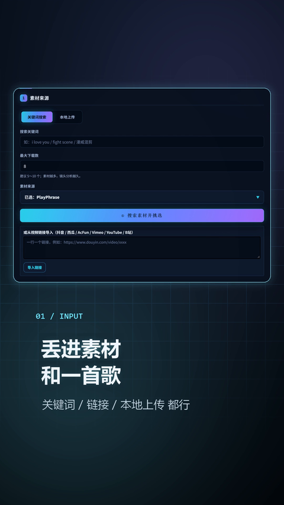
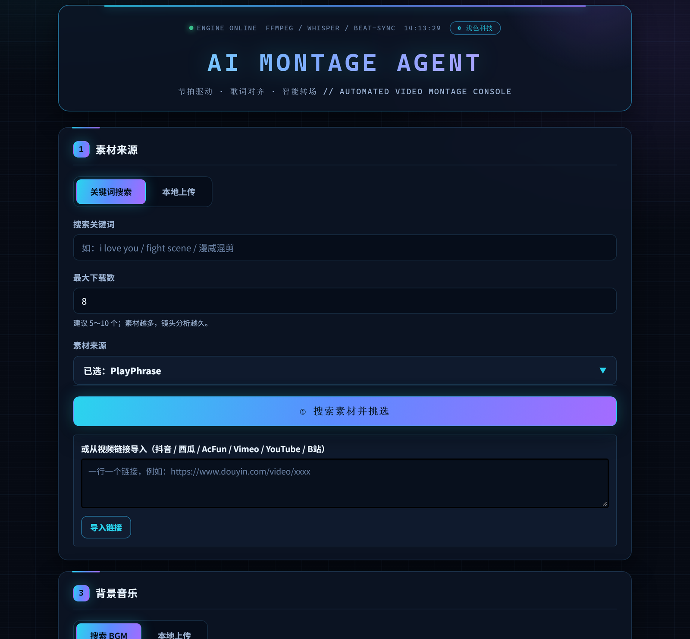
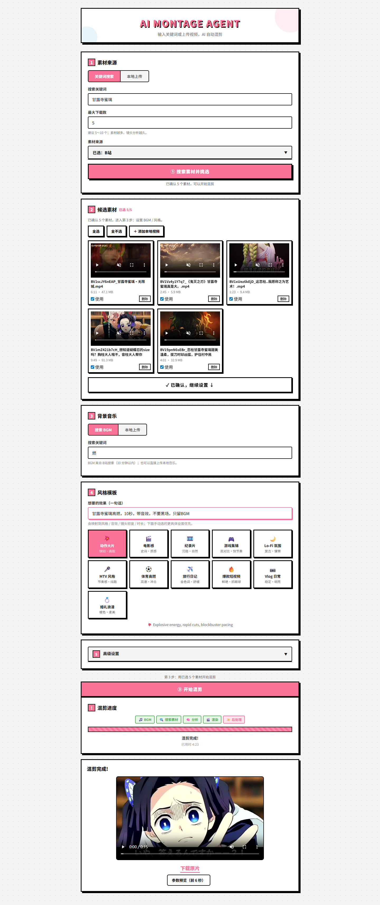

# AI Montage Agent

<p>
  
  
  
  
  
  
</p>

> **AI 自动影视混剪 Agent** —— 输入视频 + BGM，自动生成卡点混剪。<br>
> **AI-powered auto video-montage agent** — feed it clips + music, get a beat-synced edit.

**语言 / Language:** [简体中文](#简体中文) · [English](#english)

---

# 简体中文

- [功能特性](#功能特性)
- [为什么用它](#为什么用它)
- [效果展示](#效果展示)
- [快速开始](#快速开始)
- [参数说明](#参数说明)
- [素材来源](#素材来源)
- [项目结构](#项目结构)
- [技术栈](#技术栈)
- [说明](#说明)
- [许可证](#许可证)

## 功能特性

| 能力 | 说明 |
|------|------|
| ✅ 一键成片 | 素材 + BGM + 一句话，自动完成卡点混剪 |
| ✅ 卡在节拍上 | 镜头切点对齐 BGM 强弱拍，不是平均切 |
| ✅ 高光优先 | 运动/时长/表情/运镜/音频 5 维评分选镜头 |
| ✅ 丝滑转场 | 10+ 转场，按节拍强度自动选择 |
| ✅ 音效卡点 | impact / whoosh / riser 自动铺点 |
| ✅ BGM 闪避 | 人声出现时自动压低 BGM |
| ✅ 横转竖 | 主体跟踪 + 自动裁切，适配短视频 |
| ✅ 字幕生成 | Whisper 转录 + 8 种样式（可选） |
| ✅ 画面增强 | 防抖 / 降噪 / 调色 / 色彩统一 |
| ✅ 风格预设 | 11 种预设，一键切换 |
| ✅ 多源素材 | B站 / PlayPhrase / YouTube / Dailymotion + 直链 |
| ✅ 双端可用 | WebUI + CLI |
| ✅ 任务队列 | SQLite / Redis，失败重试、断点恢复 |
| ✅ LLM 导演 | 接入 OpenAI / Ollama 后自然语言控制（可选） |

## 为什么用它

- ✅ **不是随机切片**：镜头切点对齐鼓点、强拍和音乐段落。
- ✅ **不是简单拼接**：5 维高光评分先筛镜头，再排时间轴。
- ✅ **不是只有画面**：音效卡点、BGM 闪避、字幕、调色一起完成。
- ✅ **不是只适合横屏**：主体跟踪自动裁竖屏，直接发短视频。

## 效果展示

### 宣传片（30 秒 · 9:16）

<p align="center">
  <a href="docs/media/promo.mp4"></a>
</p>

30 秒讲完这条流水线：素材与 BGM 输入 → 自动分镜卡点 → 成片 → 歌词字幕 → 纪录片套版。点海报看片（`docs/media/promo.mp4`，1080×1920 / 30fps / 30s），可直接发抖音、小红书、视频号。

### WebUI 控制台

<p align="center">
  
</p>

从搜索素材、挑选 5 个候选，到确认素材并生成成片：

<p align="center">
  
</p>

## 快速开始

### 1. 环境要求

- Python 3.10+
- FFmpeg（必须）

### 2. 安装

```bash
# 安装 FFmpeg
# Windows: scoop install ffmpeg / choco install ffmpeg
# Mac:     brew install ffmpeg
# Linux:   sudo apt install ffmpeg

# 安装 Python 依赖
pip install -r requirements.txt
```

### 3. 基础用法

本地视频文件：

```bash
python pipeline.py \
  --movies movie1.mp4 movie2.mp4 \
  --bgm bgm.mp3 \
  --style dynamic \
  --output my_montage.mp4
```

关键词搜索素材（推荐 PlayPhrase，电影原片无水印）：

```bash
python pipeline.py \
  --query "i love you" \
  --bgm bgm.mp3 \
  --style dynamic \
  --output my_montage.mp4
```

B站素材（下载走 playurl API，比 yt-dlp 稳；可能有作者水印）：

```bash
python pipeline.py \
  --query "漫威混剪" \
  --source bilibili \
  --bgm bgm.mp3 \
  --style intense \
  --output my_montage.mp4
```

二次剪辑（请确认素材授权）：

```bash
python pipeline.py \
  --movies someone_montage.mp4 \
  --bgm new_bgm.mp3 \
  --style intense \
  --output my_remix.mp4
```

### 4. 高级功能

LLM 自然语言控制：

```bash
python pipeline.py \
  --movies video.mp4 \
  --bgm bgm.mp3 \
  --prompt "做一个30秒的漫威高燃混剪，橙青调色，快节奏"
```

视频增强（防抖 + 降噪 + 调色）：

```bash
python pipeline.py \
  --movies video.mp4 \
  --bgm bgm.mp3 \
  --enhance stabilize denoise color-grade
```

字幕压制：

```bash
python pipeline.py \
  --movies video.mp4 \
  --bgm bgm.mp3 \
  --subtitles tiktok
```

导出时间轴（导入 Premiere / DaVinci）：

```bash
python pipeline.py \
  --movies video.mp4 \
  --bgm bgm.mp3 \
  --export-timeline edl

# OTIO 格式（DaVinci Resolve / Premiere Pro / FCP）
python pipeline.py \
  --movies video.mp4 \
  --bgm bgm.mp3 \
  --export-timeline otio
```

使用风格预设：

```bash
python pipeline.py \
  --movies video.mp4 \
  --bgm bgm.mp3 \
  --style-preset vlog

# 可用预设：action, vlog, documentary, wedding, gaming,
#           mtv, sport, travel, cinematic, viral, lofi
```

BGM 关键词搜索（自动下载 BGM）：

```bash
python pipeline.py \
  --movies video.mp4 \
  --bgm-query "高燃 BGM" \
  --style dynamic
```

自动裁剪（横屏转竖屏）：

```bash
python pipeline.py \
  --movies video.mp4 \
  --bgm bgm.mp3 \
  --enhance auto-reframe
```

启动 WebUI：

```bash
python pipeline.py --webui
# 浏览器打开 http://localhost:8000
```

WebUI 是两段式，避免爬完直接出片：

1. 输入关键词，点 **① 搜索素材并挑选**
2. 在候选素材里勾选 / 删除 / 添加本地视频，点 **② 确认素材，继续设置**
3. 选 BGM、风格，点 **③ 开始混剪**

## 参数说明

| 参数 | 说明 | 默认值 |
|------|------|--------|
| `--movies` | 本地视频文件路径（可多个） | - |
| `--query` | 搜索关键词（与 `--movies` 二选一） | - |
| `--source` | 素材来源 | `playphrase` |
| `--clip-limit` | 最大下载片段数（仅 `--query` 模式） | `20` |
| `--bgm` | BGM 文件路径（不传则自动搜索下载） | - |
| `--bgm-query` | BGM 搜索关键词（不传则按 `--style` 自动搜索） | - |
| `--style` | 基础风格（`dynamic`/`calm`/`intense`） | `dynamic` |
| `--style-preset` | 风格预设（覆盖 `--style` 和 `--enhance`） | - |
| `--output` | 输出文件名 | `final.mp4` |
| `--threshold` | 镜头检测灵敏度（0.01~1.0，越小切得越细） | `0.2` |
| `--prompt` | 自然语言描述 | - |
| `--subtitles` | 字幕风格（`none`/`tiktok`/`youtube`/`minimal`/`karaoke`/`bold`/`cinematic`/`bilingual`） | `none` |
| `--enhance` | 视频增强（`stabilize`/`denoise`/`color-grade`/`auto-reframe`） | - |
| `--export-timeline` | 导出时间轴（`edl`/`csv`/`json`/`xml`/`otio`） | - |
| `--webui` | 启动 WebUI 界面 | - |

风格预设列表：

| 预设 | 名称 | 适用场景 |
|------|------|----------|
| `action` | 动作片 | 快节奏、高强度 |
| `vlog` | Vlog | 日常记录、轻松氛围 |
| `documentary` | 纪录片 | 沉稳、专业 |
| `wedding` | 婚礼 | 浪漫、温馨 |
| `gaming` | 游戏 | 高能、炫酷 |
| `mtv` | MTV | 音乐视频、节奏感 |
| `sport` | 体育 | 动感、激情 |
| `travel` | 旅行 | 治愈、清新 |
| `cinematic` | 电影感 | 大片质感 |
| `viral` | 爆款 | 短视频、吸睛 |
| `lofi` | Lo-fi | 复古、文艺 |

## GPU 加速（RTX 4060 实测）

### 1) FFmpeg：用 NVENC 编码 + 硬件解码

项目所有视频转码都走 `packages/montage/media.py`，默认 `auto`：

```text
MONTAGE_VIDEO_ENCODER=auto      # auto | nvenc | libx264
MONTAGE_HWACCEL=auto            # auto | cuda | off
```

- `auto` 会先做一次真实的 0.2s NVENC 编码探测，成功才用 `h264_nvenc`，
  否则自动回退 `libx264`，不会让任务失败。
- 编码参数：NVENC 用 `-preset p5 -rc vbr -cq 23 -spatial-aq 1`；
  CPU 回退用 `-crf 23 -preset fast`。
- 解码：在输入前加 `-hwaccel auto`，失败会自动去掉重试。

**本机踩到的坑**：FFmpeg 9.0.2 的 NVENC API 是 13.1，要求 NVIDIA 610+
驱动；这台机器是 591.86（只到 13.0），所以 `h264_nvenc` 会报
`Driver does not support the required nvenc API version`。
已改装 **FFmpeg 7.1.1**（NVENC API 12.2，550+ 驱动即可），并写进
`开始.bat` 的 `PATH`。验证：

```bat
ffmpeg -hide_banner -f lavfi -i color=black:s=320x240:d=0.2 ^
  -c:v h264_nvenc -preset p1 -f null -
```

无报错即 NVENC 可用。若你以后升级到 610+ 驱动，可以再换回新版 FFmpeg。

> 注意：`winget upgrade` 会把 FFmpeg 升回 9.0.2，又会回到“需要 610+ 驱动”
> 的状态。升级驱动前请保留 7.1.1（或重新执行
> `winget install --id Gyan.FFmpeg --version 7.1.1 --force`）。
> 切镜头时已直接把素材降到 1280x720，后续分析/渲染都更快，成片分辨率不变。

### 2) OpenCV：CUDA 只影响“运动分析”，不影响编码

先确认当前 wheel 是否带 CUDA：

```bat
python -c "import cv2; print(cv2.__version__, cv2.cuda.getCudaEnabledDeviceCount())"
```

输出 `0` 表示 pip 官方 wheel 不带 CUDA（本机就是 `5.0.0 / 0`）。
`MotionAnalyzer` 已做两件事：

1. 有 CUDA 版 OpenCV 时自动走 `cv2.cuda.FarnebackOpticalFlow`；
2. 没有时把画面缩到 640 宽再算 CPU 光流，并把幅度乘回原比例，
   1080p 下通常快 4~9 倍，评分口径基本不变。

所以**不建议**为了这个项目去花几小时编译 OpenCV CUDA：真正的大头是
FFmpeg 编码，NVENC 已经接管；OpenCV 只分析每个镜头的前 30 帧。

### 3) 时长/重复画面的修复

旧版 `BeatSyncEngine` 只按“每镜头 1~4 拍”累加，镜头用完就结束：
21 个镜头 × 1~2 拍 ≈ 6~10 秒，所以填 60s/600s 也只能出很短。
现在改为：

- 按目标时长给每个镜头分配秒数，自动补足到目标；
- 从镜头内部**随机取子区间**（`source_in/source_out`），同一素材每次
  取到的画面不同；
- 目标越长，自动放宽“只分析前 120s”和“最多 50 个镜头”的限制；
- 素材实在不够时明确打印警告；BGM 不够长时自动循环 BGM，不会用
  `-shortest` 把画面截断。

相关参数：WebUI 的“目标时长”上限已从 300s 放宽到 3600s；填 `0`
表示按 BGM 剩余长度自动（上限 180s）。

本机实测（同一段 120s 素材 + 90.7s BGM）：

| 目标 | 修复前 | 修复后 |
|------|--------|--------|
| 30s | 6~10s | 30.13s（13 段） |
| 60s | 10~11s | 60.03s（13 段） |
| 600s | 6s | 规划器可补足；素材不足会明确警告并复用镜头 |

另外修掉一个隐蔽问题：旧 `_prepare_clip` 在 `-i` 前用 `-t` 截取，
会让 `tpad` 看不到 EOF，每段少 0.1s 左右，长片累计少近 1 秒；
现在改用 `trim`/`atrim` 滤镜，并避开 `atempo + apad` 在 4K 源上的死锁。

### 4) 从“截取 + 配乐”到真正的卡点混剪

时长修好后，旧规划器仍会让 60 秒只有十几刀、平均 4.6 秒一刀，
转场又被压到 0.08 秒（肉眼等于硬切），所以观感像“截一段 + 配乐”。

`dynamic` / `intense` 风格现在改走
[`creative.py`](packages/montage/creative.py)：

- 切点直接取 BGM 的真实节拍时间，不再用中位拍间隔估算；
- 能量高的段落 1~2 拍一刀，能量低的段落 3~4 拍一刀，
  60 秒大约 **45~70 刀**（实测 54 个可检测画面切换，平均约 1.1s）；
- 每个镜头提前拆成多个 1~2 秒子窗口，同一素材取不同入点，
  不再是“同一个镜头从头放到尾”；
- 高能段随机加 **推镜（punch）** 和 **白闪（flash）**；
- 低能段偶尔用 0.18 秒叠化/划像，强拍保持硬切；
- 按 BGM 能量曲线选镜头运动量：高潮用高运动镜头，铺垫用平稳镜头；
- 自动叠约 17 个 impact / whoosh 音效；
- 默认加轻对比 + 轻饱和 + 暗角（用户另选调色预设时不叠加）。

`calm` 风格仍走原来的均匀卡点。想调快/调慢，改
`creative.py` 里三档 `choices` 的拍数即可；想减少特效，
调低 `effect` 的随机阈值。

本机实测同一条 60 秒成片：

| 版本 | 可检测画面切换 | 平均镜头 | 特效/音效 |
|------|----------------|----------|-----------|
| 旧版 | 12 次 | 4.6s | 无 |
| 新版 | 54 次 | 约 1.1s | 推镜 + 白闪 + 17 音效 |

GPU 编码实测（10s 720p，含解码/缩放）：

| 编码器 | 耗时 | 文件大小 |
|--------|------|----------|
| `h264_nvenc` p5 cq23 | 1.9s | 7.7 MB |
| `libx264` fast crf23 | 3.0s | 5.5 MB |

## 素材来源

| 来源 | 适合 | 接入方式 |
|------|------|----------|
| `playphrase` | 英文电影台词 | 关键词搜索（Playwright + Chrome） |
| `bilibili` | 动漫 / 影视 / 二创 | 关键词搜索 + playurl 下载 |
| `youtube` | 全品类 | 关键词搜索（需可访问网络 / cookies） |
| `dailymotion` | 全品类 | 关键词搜索 |
| `quodb` | 台词检索 | 台词 + 电影 + 时间码 |
| `douyin` / `ixigua` / `acfun` / `vimeo` | 短视频 / 影视 / 动漫 | 直链解析 |

台词源 PlayPhrase / QuoDB 需要安装 Playwright，并使用系统已安装的 Chrome：

```bash
pip install playwright
# 使用系统已安装的 Chrome 浏览器，无需额外下载 Chromium
```

## 项目结构

```text
ai-montage-agent/
├── pipeline.py              # 兼容入口（实际实现在 packages/montage）
├── requirements.txt         # Python 依赖
├── packages/
│   ├── montage/             # 核心 Pipeline（镜头/节拍/卡点/渲染）
│   ├── core_types/          # 统一数据类型
│   ├── video_crawler/       # 素材爬取（B站/YouTube/台词搜索/BGM 搜索）
│   ├── video_enhancement/   # 视频增强（防抖/降噪/调色/裁剪/闪避/主体追踪）
│   ├── subtitle_engine/     # 字幕引擎（Whisper 转录 + 压制）
│   ├── ai_director/         # LLM 自然语言控制
│   ├── timeline_export/     # 时间轴导出（EDL/CSV/JSON/XML/OTIO）
│   ├── sound_engine/        # 音效卡点（impact/whoosh）
│   ├── audio_mixer/         # 多轨混音
│   ├── montage_engine/      # 蒙太奇引擎（10+ 种转场）
│   ├── render_engine/       # 渲染引擎（FFmpeg 执行器）
│   └── webui/               # WebUI（FastAPI + B站漫画风格前端）
├── apps/                    # 入口说明（主入口是 pipeline.py / --webui）
├── scripts/                 # smoke/ 冒烟测试 + demo/ 演示
├── artifacts/               # 演示样片（gitignored）
├── var/                     # 运行产物 cache/output/uploads（gitignored）
└── tests/                   # pytest
```

## 技术栈

- **视频处理**：FFmpeg、OpenCV
- **音频分析**：librosa
- **字幕**：openai-whisper / faster-whisper（可选）
- **LLM**：OpenAI 兼容 API（可选，支持 Ollama 本地部署）
- **WebUI**：FastAPI + SSE
- **素材爬取**：yt-dlp + B站 API + Playwright（台词搜索）

## 说明

- 抖音 / 西瓜 / AcFun / Vimeo 通过直链解析；WebUI 的 URL 输入框还在接入。
- YouTube / Dailymotion 需要可访问的网络环境；YARN / 找台词网受反爬和站点状态影响。
- Whisper 字幕、LLM 导演是可选能力，不安装也能跑基础混剪。
- 素材版权归原作者所有，发布或商用前请确认授权。
- 工程实现是确定性混剪流水线，LLM 用于可选的参数解析。

## 许可证

[MIT License](LICENSE)

[⬆ 返回顶部 / Back to top](#ai-montage-agent)

如果这个项目对你有帮助，欢迎赞赏支持 ☕


---

# English

- [Features](#features)
- [Why use it](#why-use-it)
- [Quick Start](#quick-start)
- [Arguments](#arguments)
- [Sources](#sources)
- [Project Structure](#project-structure)
- [Tech Stack](#tech-stack)
- [Notes](#notes)
- [License](#license)

## Features

| Capability | What it does |
|------------|--------------|
| ✅ One-click edit | Clips + BGM + one prompt → finished beat-synced montage |
| ✅ On-beat cuts | Shot cuts aligned to strong/weak beats, not evenly spaced |
| ✅ Highlight-first | 5-axis scoring (motion / duration / faces / camera / audio) |
| ✅ Smooth transitions | 10+ transitions chosen by beat intensity |
| ✅ SFX on beats | impact / whoosh / riser cues placed automatically |
| ✅ BGM ducking | Music ducks under dialogue |
| ✅ Landscape → portrait | Subject tracking + auto reframe for short-form |
| ✅ Subtitles | Whisper transcription + 8 styles (optional) |
| ✅ Enhancement | Stabilize / denoise / color grade / color harmonize |
| ✅ Style presets | 11 one-click presets |
| ✅ Multi-source | Bilibili / PlayPhrase / YouTube / Dailymotion + direct URLs |
| ✅ WebUI + CLI | Browser UI and command line |
| ✅ Task queue | SQLite / Redis, retries and resume |
| ✅ LLM director | Optional natural-language control via OpenAI / Ollama |

## Why use it

- ✅ **Not random cuts** — cuts land on drums, strong beats, and song sections.
- ✅ **Not just stitching** — 5-axis highlight scoring picks shots before the timeline.
- ✅ **Not just video** — SFX, BGM ducking, subtitles, and color are handled together.
- ✅ **Not landscape-only** — subject tracking auto-reframes to vertical for short-form.

> UI showcase: [see the full-page screenshot](#效果展示) in the Chinese section.

## Quick Start

### 1. Requirements

- Python 3.10+
- FFmpeg (required)

### 2. Installation

```bash
# Install FFmpeg
# Windows: scoop install ffmpeg / choco install ffmpeg
# Mac:     brew install ffmpeg
# Linux:   sudo apt install ffmpeg

# Install Python dependencies
pip install -r requirements.txt
```

### 3. Basic Usage

Local video files:

```bash
python pipeline.py \
  --movies movie1.mp4 movie2.mp4 \
  --bgm bgm.mp3 \
  --style dynamic \
  --output my_montage.mp4
```

Search clips by keyword (PlayPhrase recommended — original film clips, no watermark):

```bash
python pipeline.py \
  --query "i love you" \
  --bgm bgm.mp3 \
  --style dynamic \
  --output my_montage.mp4
```

Bilibili clips (playurl API is used for downloads; may carry creator watermarks):

```bash
python pipeline.py \
  --query "marvel montage" \
  --source bilibili \
  --bgm bgm.mp3 \
  --style intense \
  --output my_montage.mp4
```

Re-edit existing footage (make sure you have the rights):

```bash
python pipeline.py \
  --movies someone_montage.mp4 \
  --bgm new_bgm.mp3 \
  --style intense \
  --output my_remix.mp4
```

### 4. Advanced Features

LLM natural-language control:

```bash
python pipeline.py \
  --movies video.mp4 \
  --bgm bgm.mp3 \
  --prompt "make a 30s high-energy Marvel montage, teal-orange grade, fast cuts"
```

Video enhancement (stabilize + denoise + color grade):

```bash
python pipeline.py \
  --movies video.mp4 \
  --bgm bgm.mp3 \
  --enhance stabilize denoise color-grade
```

Burn-in subtitles:

```bash
python pipeline.py \
  --movies video.mp4 \
  --bgm bgm.mp3 \
  --subtitles tiktok
```

Export timeline (import into Premiere / DaVinci):

```bash
python pipeline.py \
  --movies video.mp4 \
  --bgm bgm.mp3 \
  --export-timeline edl

# OTIO format (DaVinci Resolve / Premiere Pro / FCP)
python pipeline.py \
  --movies video.mp4 \
  --bgm bgm.mp3 \
  --export-timeline otio
```

Use a style preset:

```bash
python pipeline.py \
  --movies video.mp4 \
  --bgm bgm.mp3 \
  --style-preset vlog

# Available presets: action, vlog, documentary, wedding, gaming,
#                    mtv, sport, travel, cinematic, viral, lofi
```

Search BGM by keyword (auto-download):

```bash
python pipeline.py \
  --movies video.mp4 \
  --bgm-query "epic BGM" \
  --style dynamic
```

Auto-reframe (landscape → portrait):

```bash
python pipeline.py \
  --movies video.mp4 \
  --bgm bgm.mp3 \
  --enhance auto-reframe
```

Launch the WebUI:

```bash
python pipeline.py --webui
# Open http://localhost:8000 in your browser
```

The WebUI is a two-stage flow:

1. Enter a keyword, click **① Search & pick clips**
2. Select / delete / add local clips, click **② Confirm clips**
3. Choose BGM and style, click **③ Start montage**

## Arguments

| Argument | Description | Default |
|----------|-------------|---------|
| `--movies` | Local video file paths (one or more) | - |
| `--query` | Search keyword (mutually exclusive with `--movies`) | - |
| `--source` | Clip source | `playphrase` |
| `--clip-limit` | Max clips to download (`--query` mode only) | `20` |
| `--bgm` | BGM file path (auto-searched if omitted) | - |
| `--bgm-query` | BGM search keyword (auto by `--style` if omitted) | - |
| `--style` | Base style (`dynamic`/`calm`/`intense`) | `dynamic` |
| `--style-preset` | Style preset (overrides `--style` and `--enhance`) | - |
| `--output` | Output filename | `final.mp4` |
| `--threshold` | Shot detection sensitivity (0.01~1.0, lower = finer cuts) | `0.2` |
| `--prompt` | Natural-language description | - |
| `--subtitles` | Subtitle style (`none`/`tiktok`/`youtube`/`minimal`/`karaoke`/`bold`/`cinematic`/`bilingual`) | `none` |
| `--enhance` | Enhancements (`stabilize`/`denoise`/`color-grade`/`auto-reframe`) | - |
| `--export-timeline` | Timeline export (`edl`/`csv`/`json`/`xml`/`otio`) | - |
| `--webui` | Launch the WebUI | - |

Style presets:

| Preset | Name | Best for |
|--------|------|----------|
| `action` | Action | Fast-paced, high-intensity |
| `vlog` | Vlog | Everyday, relaxed |
| `documentary` | Documentary | Steady, professional |
| `wedding` | Wedding | Romantic, warm |
| `gaming` | Gaming | High-energy, flashy |
| `mtv` | MTV | Music video, rhythmic |
| `sport` | Sport | Dynamic, passionate |
| `travel` | Travel | Soothing, fresh |
| `cinematic` | Cinematic | Blockbuster feel |
| `viral` | Viral | Short-form, eye-catching |
| `lofi` | Lo-fi | Retro, artsy |

## Sources

| Source | Best for | How it works |
|--------|----------|--------------|
| `playphrase` | English film quotes | Keyword search (Playwright + Chrome) |
| `bilibili` | Anime / film / fan edits | Keyword search + playurl download |
| `youtube` | All categories | Keyword search (network / cookies required) |
| `dailymotion` | All categories | Keyword search |
| `quodb` | Quote lookup | Quote + film + timecode |
| `douyin` / `ixigua` / `acfun` / `vimeo` | Short-form / film / anime | Direct URL parsing |

PlayPhrase / QuoDB require Playwright and the system-installed Chrome:

```bash
pip install playwright
# Uses the system-installed Chrome browser; no extra Chromium download needed
```

## Project Structure

```text
ai-montage-agent/
├── pipeline.py              # Compatibility entry (implementation in packages/montage)
├── requirements.txt         # Python dependencies
├── packages/
│   ├── montage/             # Core pipeline (shots/beats/sync/render)
│   ├── core_types/          # Shared data types
│   ├── video_crawler/       # Clip crawling (Bilibili/YouTube/quote/BGM search)
│   ├── video_enhancement/   # Enhancement (stabilize/denoise/grade/reframe/ducking/tracking)
│   ├── subtitle_engine/     # Subtitle engine (Whisper transcribe + burn-in)
│   ├── ai_director/         # LLM natural-language control
│   ├── timeline_export/     # Timeline export (EDL/CSV/JSON/XML/OTIO)
│   ├── sound_engine/        # Beat-synced SFX (impact/whoosh)
│   ├── audio_mixer/         # Multi-track audio mixing
│   ├── montage_engine/      # Montage engine (10+ transitions)
│   ├── render_engine/       # Render engine (FFmpeg executor)
│   └── webui/               # WebUI (FastAPI + Bilibili-comic-style frontend)
├── apps/                    # Entry-point notes (main entry: pipeline.py / --webui)
├── scripts/                 # smoke/ tests + demo/ samples
├── artifacts/               # Demo renders (gitignored)
├── var/                     # Runtime artifacts cache/output/uploads (gitignored)
└── tests/                   # pytest
```

## Tech Stack

- **Video processing**: FFmpeg, OpenCV
- **Audio analysis**: librosa
- **Subtitles**: openai-whisper / faster-whisper (optional)
- **LLM**: OpenAI-compatible API (optional, supports local Ollama)
- **WebUI**: FastAPI + SSE
- **Clip crawling**: yt-dlp + Bilibili API + Playwright (quote search)

## Notes

- Douyin / Xigua / AcFun / Vimeo use direct-URL parsing; the WebUI URL input is still being wired up.
- YouTube / Dailymotion depend on network access; YARN / Zhaotaici are affected by anti-bot and site status.
- Whisper subtitles and LLM direction are optional; the core montage works without them.
- All footage remains the property of its original creator; clear the rights before publishing or commercial use.
- Under the hood this is a deterministic montage pipeline; the LLM parses optional parameters.

## License

[MIT License](LICENSE)

[⬆ Back to top](#ai-montage-agent)

If this project helps you, feel free to buy me a coffee ☕


