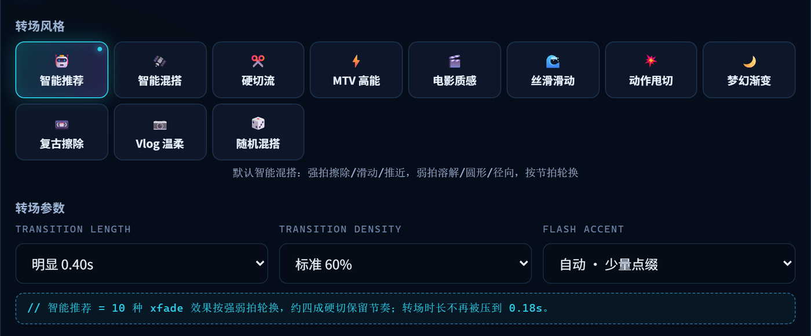

# AI Montage Plus

<p>
  
  
  
  
  
  
</p>

> **你负责拍，它负责剪。**
>
> 把一堆素材和一首歌丢进去，剩下的它自己干：拆镜头 → 数节拍 → 挑高光 → 卡点排时间轴 → 配转场音效字幕。
> 你去泡杯茶，回来拿一条能直接发抖音的 1080×1920 成片。全程本机跑，不上传云端，不花钱。

> [!IMPORTANT]
> **二次创作声明**
> 本项目基于 [@zhangzhanglaila](https://github.com/zhangzhanglaila) 的开源项目
> **[ai-montage-agent](https://github.com/zhangzhanglaila/ai-montage-agent)** 二次开发。
> 原版提供了完整可用的混剪内核（拆镜头、节拍分析、高光评分、素材抓取、时间轴导出）；
> 我在它上面修缺陷、补功能、重做前端，并重写了这份文档。
> 原项目采用 MIT 许可证，本项目保留其原始版权声明，详见 [LICENSE](LICENSE) 与[文末声明](#关于这个项目二次创作声明)。

**语言 / Language:** [简体中文](#简体中文) · [English](#english)

---

# 简体中文

- [三十秒读懂这个项目](#三十秒读懂这个项目)
- [效果展示](#效果展示)
- [二次开发增量](#二次开发增量)
- [功能特性](#功能特性)
- [快速开始](#快速开始)
- [参数说明](#参数说明)
- [风格预设](#风格预设)
- [素材来源](#素材来源)
- [项目结构](#项目结构)
- [技术栈与性能](#技术栈与性能)
- [关于这个项目（二次创作声明）](#关于这个项目二次创作声明)
- [许可证](#许可证)

## 三十秒读懂这个项目

人工剪一条 60 秒的竖屏片，正常要 1~2 小时：翻素材挑高光、卡鼓点、调转场、找音效、敲字幕。

这个工具把这些重复劳动全部自动化，你只需要给两样东西：

```text
素材（本地视频 / 关键词搜索 / 直链）┐
                                    ├─→ 拆镜头 → 数节拍 → 高光打分 → 卡点排轴 → 转场·音效·字幕 → 成片
BGM（本地音频 / 关键词搜索）        ┘
```

它**不是**把片段随机拼起来：

- 切点落在 BGM 的真实鼓点和段落线上，不是平均每 2 秒切一刀；
- 先给每个镜头打 5 维分（运动 / 时长 / 人脸 / 运镜 / 音频），高分镜头优先上场；
- 高能段 1~2 拍一刀、铺垫段 3~4 拍一刀，转场和推镜白闪跟着能量走；
- 音效卡点、BGM 人声闪避、字幕、调色、横转竖一起做完。

产物是标准 H.264 + AAC，直接进剪映二次调整，或者导出 EDL / OTIO 回 Premiere / DaVinci 继续改。

## 效果展示

### 宣传片（60 秒 · 9:16）

<p align="center">
  <a href="docs/media/promo.mp4"></a>
</p>

60 秒讲完这条流水线：素材输入 → 节拍可视化分镜 → 卡点快切 → 转场设置 → 字幕 → 纪录片套版 → 片尾。
点海报看片（`docs/media/promo.mp4`，720×1280 / 60s，仓库内的压缩预览版），可直接发抖音、小红书、视频号。

### WebUI 控制台

<p align="center">
  
</p>

高级设置里的转场区（这一版新增的能力都在这儿）：

<p align="center">
  
</p>

> 11 个风格卡片 + 转场时长 / 密度 / 白闪三个下拉。默认「智能推荐」即可：
> 10 种 xfade 按强弱拍轮换，约四成保留硬切，转场时长不再被压到 0.18s。

## 二次开发增量

相比原版，这一版主要动了四块（完整改动记录见 [docs/CONTRIBUTIONS.md](docs/CONTRIBUTIONS.md)）：

| 方向 | 原版 | 现在 |
|------|------|------|
| **转场** | 视觉上只有一种“快闪”，模板参数收了但没真正生效 | 10 种 xfade 按强弱拍智能混搭，相邻两刀不重复；**时长 / 密度 / 白闪**三项在高级设置里可调 |
| **字幕** | 收尾漏识别的最后一句被当成“未演唱”丢弃，片尾整段无字幕 | 按人声能量跨度补回漏句，末句延到片尾渐弱；对齐报告可查 |
| **WebUI** | B 站漫画风界面 | 科技控制台风格（深色玻璃拟态 + 霓虹描边 + 切换浅色主题），DOM 与接口零改动 |
| **渲染稳定性** | 偶发掉帧、长片时间线在中途冻结、AAC 削波 | 修掉 4 个时序 bug（xfade 丢帧率 / `-r` 重采样 / 长链 PTS 回绕 / 短素材冻结），音画严格齐长 |

配套：新增 7 个回归测试（转场混搭 6 例 + 字幕尾部 1 例），零参数默认链路回归 56 项通过，并用两条真实成片（86.7s 纪录片混剪 + 60s 竖屏宣传片）验证全链路。

## 功能特性

| 能力 | 说明 | 来源 |
|------|------|------|
| ✅ 一键成片 | 素材 + BGM + 一句话，自动完成卡点混剪 | 原版 |
| ✅ 卡在节拍上 | 镜头切点对齐 BGM 强弱拍，不是平均切 | 原版 |
| ✅ 高光优先 | 运动 / 时长 / 表情 / 运镜 / 音频 5 维评分选镜头 | 原版 |
| ✅ 转场混搭 | 10 种 xfade 按强弱拍轮换，时长密度白闪可调 | **二次开发** |
| ✅ 音效卡点 | impact / whoosh / riser 自动铺点 | 原版 |
| ✅ BGM 闪避 | 人声出现时自动压低 BGM | 原版 |
| ✅ 横转竖 | 主体跟踪 + 自动裁切，适配短视频 | 原版 |
| ✅ 字幕生成 | Whisper 转录 + 8 种样式，尾部漏句自动补回 | 原版 + **修复** |
| ✅ 画面增强 | 防抖 / 降噪 / 调色 / 色彩统一 | 原版 |
| ✅ 风格预设 | 11 种预设，一键切换 | 原版 |
| ✅ 多源素材 | B站 / PlayPhrase / YouTube / Dailymotion + 直链 | 原版 |
| ✅ 双端可用 | WebUI + CLI | 原版 |
| ✅ 任务队列 | SQLite / Redis，失败重试、断点恢复 | 原版 |
| ✅ LLM 导演 | 接入 OpenAI / Ollama 后自然语言控制（可选） | 原版 |

## 快速开始

### 1. 环境要求

- Python 3.10+
- FFmpeg（必须，建议 7.x）

### 2. 安装

```bash
# FFmpeg
# Windows: scoop install ffmpeg / choco install ffmpeg
# Mac:     brew install ffmpeg
# Linux:   sudo apt install ffmpeg

pip install -r requirements.txt
```

Windows 用户也可以直接双击 **`开始.bat`**（会自动把 FFmpeg 加进 PATH 并启动 WebUI）。

### 3. 本地素材 + 本地 BGM

```bash
python pipeline.py \
  --movies movie1.mp4 movie2.mp4 \
  --bgm bgm.mp3 \
  --style dynamic \
  --output my_montage.mp4
```

### 4. 关键词搜素材（不提供素材也行）

```bash
# 英文电影台词（PlayPhrase，原片无水印）
python pipeline.py --query "i love you" --bgm bgm.mp3 --output my_montage.mp4

# B站（走 playurl API，比 yt-dlp 稳；可能有作者水印）
python pipeline.py --query "漫威混剪" --source bilibili --style intense --output my_montage.mp4
```

### 5. 启动 WebUI

```bash
python pipeline.py --webui
# 浏览器打开 http://localhost:8000
```

WebUI 是三段式，避免“爬完直接出片”：

1. 输入关键词，点 **① 搜索素材并挑选**
2. 在候选里勾选 / 删除 / 追加本地视频，点 **② 确认素材，继续设置**
3. 选 BGM、风格、目标时长、转场参数，点 **③ 开始混剪**

高级设置里的转场三项（**时长 0.25~0.70s / 密度 25%~100% / 白闪 关闭或少量或较多**）是这一版新增的，默认“智能混搭”即可。

### 6. 进阶用法

```bash
# LLM 自然语言控制
python pipeline.py --movies video.mp4 --bgm bgm.mp3 \
  --prompt "做一个 30 秒的高燃混剪，橙青调色，快节奏"

# 视频增强
python pipeline.py --movies video.mp4 --bgm bgm.mp3 --enhance stabilize denoise color-grade

# 字幕压制（8 种样式）
python pipeline.py --movies video.mp4 --bgm bgm.mp3 --subtitles tiktok

# 横屏转竖屏
python pipeline.py --movies video.mp4 --bgm bgm.mp3 --enhance auto-reframe

# 导出时间轴回剪辑软件（EDL / CSV / JSON / XML / OTIO）
python pipeline.py --movies video.mp4 --bgm bgm.mp3 --export-timeline otio
```

## 参数说明

| 参数 | 说明 | 默认值 |
|------|------|--------|
| `--movies` | 本地视频文件路径（可多个） | - |
| `--query` | 搜索关键词（与 `--movies` 二选一） | - |
| `--source` | 素材来源 | `playphrase` |
| `--clip-limit` | 最大下载片段数（仅 `--query` 模式） | `20` |
| `--bgm` | BGM 文件路径（不传则自动搜索下载） | - |
| `--bgm-query` | BGM 搜索关键词（不传则按 `--style` 自动搜索） | - |
| `--style` | 基础风格（`dynamic`/`calm`/`intense`） | `dynamic` |
| `--style-preset` | 风格预设（覆盖 `--style` 和 `--enhance`） | - |
| `--output` | 输出文件名 | `final.mp4` |
| `--threshold` | 镜头检测灵敏度（0.01~1.0，越小切得越细） | `0.2` |
| `--prompt` | 自然语言描述 | - |
| `--subtitles` | 字幕风格（`none`/`tiktok`/`youtube`/`minimal`/`karaoke`/`bold`/`cinematic`/`bilingual`） | `none` |
| `--enhance` | 视频增强（`stabilize`/`denoise`/`color-grade`/`auto-reframe`） | - |
| `--export-timeline` | 导出时间轴（`edl`/`csv`/`json`/`xml`/`otio`） | - |
| `--webui` | 启动 WebUI 界面 | - |

WebUI 侧新增的转场参数（API 字段同名）：

| 字段 | 取值范围 | 默认值 |
|------|----------|--------|
| `transition_length` | 0.05~0.80 秒 | `0.40` |
| `transition_density` | 0.0~1.0（转场占比） | `0.60` |
| `transition_flash` | `auto` / `off` / `low` / `high` | `auto` |

## 风格预设

| 预设 | 名称 | 适用场景 |
|------|------|----------|
| `action` | 动作片 | 快节奏、高强度 |
| `vlog` | Vlog | 日常记录、轻松氛围 |
| `documentary` | 纪录片 | 沉稳、专业 |
| `wedding` | 婚礼 | 浪漫、温馨 |
| `gaming` | 游戏 | 高能、炫酷 |
| `mtv` | MTV | 音乐视频、节奏感 |
| `sport` | 体育 | 动感、激情 |
| `travel` | 旅行 | 治愈、清新 |
| `cinematic` | 电影感 | 大片质感 |
| `viral` | 爆款 | 短视频、吸睛 |
| `lofi` | Lo-fi | 复古、文艺 |

```bash
python pipeline.py --movies video.mp4 --bgm bgm.mp3 --style-preset vlog
```

## 素材来源

| 来源 | 适合 | 接入方式 |
|------|------|----------|
| `playphrase` | 英文电影台词 | 关键词搜索（Playwright + 系统 Chrome） |
| `bilibili` | 动漫 / 影视 / 二创 | 关键词搜索 + playurl 下载 |
| `youtube` | 全品类 | 关键词搜索（需可访问网络 / cookies） |
| `dailymotion` | 全品类 | 关键词搜索 |
| `quodb` | 台词检索 | 台词 + 电影 + 时间码 |
| `douyin` / `ixigua` / `acfun` / `vimeo` | 短视频 / 影视 / 动漫 | 直链解析 |

台词源 PlayPhrase / QuoDB 需要 Playwright，并使用系统已安装的 Chrome：

```bash
pip install playwright
# 用系统已装 Chrome，无需额外下载 Chromium
```

## 项目结构

```text
AI-Montage-Plus/
├── pipeline.py              # 兼容入口（实际实现在 packages/montage）
├── requirements.txt         # Python 依赖
├── 开始.bat                 # Windows 一键启动（FFmpeg PATH + WebUI）
├── packages/
│   ├── montage/             # 核心 Pipeline（镜头/节拍/卡点/渲染）
│   ├── core_types/          # 统一数据类型
│   ├── video_crawler/       # 素材爬取（B站/YouTube/台词搜索/BGM 搜索）
│   ├── video_enhancement/   # 视频增强（防抖/降噪/调色/裁剪/闪避/主体追踪）
│   ├── subtitle_engine/     # 字幕引擎（Whisper 转录 + 压制 + 歌词对齐）
│   ├── ai_director/         # LLM 自然语言控制
│   ├── timeline_export/     # 时间轴导出（EDL/CSV/JSON/XML/OTIO）
│   ├── sound_engine/        # 音效卡点（impact/whoosh）
│   ├── audio_mixer/         # 多轨混音
│   ├── montage_engine/      # 蒙太奇引擎（10+ 种转场）
│   ├── render_engine/       # 渲染引擎（FFmpeg 执行器）
│   └── webui/               # WebUI（FastAPI + SSE + 前端）
├── docs/
│   ├── media/promo.mp4      # 宣传片（压缩预览版）
│   └── CONTRIBUTIONS.md     # 二次开发改动记录
├── scripts/                 # smoke 冒烟测试 + demo 演示
├── var/                     # 运行产物 cache/output/uploads（gitignored）
└── tests/                   # pytest
```

## 技术栈与性能

**核心**：FFmpeg（转码/滤镜/字幕）· OpenCV（光流/主体跟踪）· librosa（节拍与能量）· PySceneDetect（镜头切分）· FastAPI + SSE（WebUI）· yt-dlp + Playwright（素材抓取）· Whisper（字幕，可选）· OpenAI 兼容 API 或 Ollama（LLM 导演，可选）

### GPU 加速（RTX 4060 实测）

编码走 `packages/montage/media.py`，默认 `auto`：

```text
MONTAGE_VIDEO_ENCODER=auto      # auto | nvenc | libx264
MONTAGE_HWACCEL=auto            # auto | cuda | off
```

- `auto` 会先做一次真实的 0.2s NVENC 编码探测，成功才用 `h264_nvenc`，否则自动回退 `libx264`，不会让任务失败。
- 编码参数：NVENC `-preset p5 -rc vbr -cq 23 -spatial-aq 1`；CPU 回退 `-crf 23 -preset fast`。

| 编码器 | 10s 720p 耗时 | 文件大小 |
|--------|---------------|----------|
| `h264_nvenc` p5 cq23 | 1.9s | 7.7 MB |
| `libx264` fast crf23 | 3.0s | 5.5 MB |

> **踩坑**：FFmpeg 9.0.2 的 NVENC API 是 13.1，要求 NVIDIA 610+ 驱动；591 驱动下会报
> `Driver does not support the required nvenc API version`。改用 FFmpeg 7.1.1（NVENC API 12.2，550+ 驱动即可）。
> 验证：`ffmpeg -hide_banner -f lavfi -i color=black:s=320x240:d=0.2 -c:v h264_nvenc -preset p1 -f null -` 无报错即可。
> 注意 `winget upgrade` 会把 FFmpeg 升回新版，升级驱动前请保留 7.1.1。

OpenCV 的 CUDA 只影响“运动分析”，不影响编码：有 CUDA 版 wheel 时自动走 `cv2.cuda.FarnebackOpticalFlow`，没有则把画面缩到 640 宽算 CPU 光流再乘回比例，1080p 下快 4~9 倍。**不建议**为此编译 OpenCV CUDA，真正的瓶颈是 FFmpeg 编码，NVENC 已经接管。

## 关于这个项目（二次创作声明）

### 它从哪来

| | 项目 | 作者 | 说明 |
|---|------|------|------|
| 原版 | [ai-montage-agent](https://github.com/zhangzhanglaila/ai-montage-agent) | [@zhangzhanglaila](https://github.com/zhangzhanglaila) | 提供了完整的混剪内核：镜头切分、节拍检测、高光评分、素材抓取、时间轴导出，MIT 许可，可直接运行 |
| 本项目 | AI-Montage-Plus | 本仓库维护者 | 在原作者代码基础上二次开发：修缺陷、加功能、重做前端、补测试、重写文档 |

原版是一个工程量相当完整的项目，这条流水线能跑起来主要靠它。我做的是“把它变得能稳定出片、能让人自己调”。

### 我做了什么

1. **字幕**：修掉片尾漏识别整句被丢弃的问题，改按人声能量跨度补回，末句渐弱收尾。
2. **转场**：从“永远一种快闪”改成节拍驱动的可配置混搭，并修掉模板未生效、时长被压制、效果池变量覆盖三处 bug。
3. **参数化**：高级设置新增转场时长 / 密度 / 白闪，前端到规划器全线打通。
4. **前端**：整站重做为科技控制台风格，支持深浅主题切换，功能零回归。
5. **稳定性**：修掉 xfade 丢帧率、`-r` 重采样丢帧、长链 PTS 回绕、短素材时间线冻结四个渲染 bug；处理 AAC 削波。
6. **测试与验证**：新增 7 个回归测试，56 项零参数回归，两条真实成片（纪录片混剪 86.7s、宣传片 60s）端到端验证。

细节、数据与验证方法见 [docs/CONTRIBUTIONS.md](docs/CONTRIBUTIONS.md)。

### 致谢

- 原项目 [ai-montage-agent](https://github.com/zhangzhanglaila/ai-montage-agent) — [@zhangzhanglaila](https://github.com/zhangzhanglaila)
  （如果这个工具帮到你，也去给原作者点个 ⭐）
- [FFmpeg](https://ffmpeg.org/) · [OpenCV](https://opencv.org/) · [librosa](https://librosa.org/) · [PySceneDetect](https://github.com/Breakthrough/PySceneDetect) · [FastAPI](https://fastapi.tiangolo.com/) · [yt-dlp](https://github.com/yt-dlp/yt-dlp) · [Whisper](https://github.com/openai/whisper)

### 素材与版权

- 演示片中的游戏画面来自《影之刃零》，版权归原作者所有，仅作技术演示。
- 素材源（B站 / YouTube / PlayPhrase 等）的版权归各自权利人，发布或商用前请自行确认授权。
- 本项目不自带任何素材，不提供任何破解或去水印能力。

## 许可证

[MIT License](LICENSE) —— 保留原作者版权声明，二次开发部分同样以 MIT 发布。

[⬆ 返回顶部](#ai-montage-plus)

---

# English

**AI Montage Plus** — a beat-synced automatic video montage agent. Feed it clips and a song, get a finished vertical edit: shot detection → beat analysis → highlight scoring → beat-aligned timeline → transitions, SFX, subtitles.

> **Fork notice:** this is a derivative work of **[ai-montage-agent](https://github.com/zhangzhanglaila/ai-montage-agent)** by **[@zhangzhanglaila](https://github.com/zhangzhanglaila)** (MIT). The upstream project provides the montage core; this fork fixes defects, adds transition controls, rebuilds the WebUI, and adds tests. Original copyright is preserved — see [LICENSE](LICENSE).

- [What it is](#what-it-is)
- [What this fork changes](#what-this-fork-changes)
- [Quick start](#quick-start)
- [License](#license)

## What it is

Hand-editing a 60-second vertical video takes 1–2 hours: hunting highlights, cutting on the beat, tuning transitions, adding SFX, typing subtitles. This tool automates the boring 90%:

- cuts land on real drum hits and song sections — not on a fixed 2-second grid;
- shots are scored on 5 axes (motion / duration / faces / camera / audio) before the timeline is built;
- 1–2 beats per cut in high-energy sections, 3–4 in build-ups; punch-ins and flashes follow the energy curve;
- SFX cues, BGM ducking, subtitles, color and landscape→portrait reframing are all handled.

Output is plain H.264 + AAC — ready for CapCut, or export EDL / OTIO back into Premiere / DaVinci.

## What this fork changes

| Area | Upstream | This fork |
|------|----------|-----------|
| Transitions | effectively one flash style; template ignored | 10 xfade types mixed by beat strength, no repeat back-to-back; length / density / flash exposed in the UI |
| Subtitles | final line dropped when Whisper missed it | re-inserted from vocal span, fades out at the tail |
| WebUI | comic-style UI | "tech console" theme with light/dark switch, zero DOM/API changes |
| Stability | dropped frames, timeline freeze on long cuts, AAC clipping | 4 timing bugs fixed: xfade metadata loss, `-r` resampling, long-chain PTS wrap, short-clip freeze |

Full changelog: [docs/CONTRIBUTIONS.md](docs/CONTRIBUTIONS.md).

## Quick start

```bash
pip install -r requirements.txt

python pipeline.py --movies a.mp4 b.mp4 --bgm song.mp3 --style dynamic --output out.mp4

python pipeline.py --query "i love you" --bgm song.mp3          # search clips by keyword
python pipeline.py --webui                                       # http://localhost:8000
```

| Argument | Description | Default |
|----------|-------------|---------|
| `--movies` | Local video files | - |
| `--query` | Keyword search (instead of `--movies`) | - |
| `--source` | `playphrase` / `bilibili` / `youtube` / `dailymotion` | `playphrase` |
| `--bgm` | BGM file (auto-searched if omitted) | - |
| `--style` | `dynamic` / `calm` / `intense` | `dynamic` |
| `--style-preset` | 11 presets (`action`, `vlog`, `documentary`, `wedding`, `gaming`, `mtv`, `sport`, `travel`, `cinematic`, `viral`, `lofi`) | - |
| `--subtitles` | 8 styles or `none` | `none` |
| `--enhance` | `stabilize` / `denoise` / `color-grade` / `auto-reframe` | - |
| `--export-timeline` | `edl` / `csv` / `json` / `xml` / `otio` | - |
| `--webui` | Launch the browser UI | - |

## License

[MIT](LICENSE). Upstream copyright (ai-montage-agent by zhangzhanglaila) preserved; fork released under the same license.

[⬆ Back to top](#ai-montage-plus)
